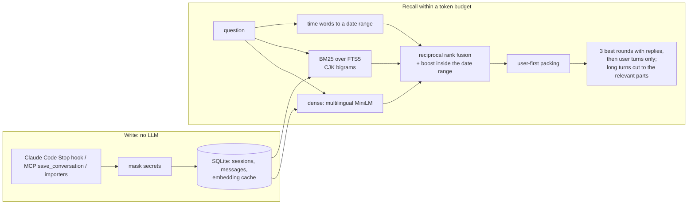

# pocket-recall

**Lossless, local long-term memory for your AI assistant.** Every conversation is kept verbatim in one SQLite file on your machine. When the assistant needs the past, pocket-recall picks the parts that matter and fits them into a small token budget (2k–8k tokens), so even a small context window can draw on months of history.

- **Nothing is summarised or thrown away.** No LLM runs on the write path: no API key, no per-message cost, no detail lost to an extractor.
- **Local and light.** One SQLite file plus a 0.22 GB multilingual embedding model on CPU. Recall takes about 0.3 s on a 240k-token history.
- **Measured.** Recall is checked on LongMemEval-S and on LoCoMo, which was held out from all tuning. End-to-end answers are judged with the official prompts, and per-question results are published so you can recompute every number. Experiments that did not help are reported too.
- **Chinese and English.** CJK-aware keyword search, plus time expressions in both languages ("上周", "三月份", "last week", "two weeks ago").

[中文说明](README.zh-CN.md) · [Evaluation report](docs/EVALUATION.md)

## Install in Claude Code

```
/plugin install pocket-recall --marketplace Cranedon/pocket-recall
```

The plugin bundles four things:

- an MCP server with a `recall` tool;
- a Stop hook that saves each turn of every session (your prompts and Claude's written replies, not tool output);
- a prompt hook that adds relevant memory to a prompt on its own, when there is some (see [Automatic injection](#automatic-injection));
- a skill that tells Claude when to look things up.

It needs [uv](https://docs.astral.sh/uv/). On first start it sets up its own environment (about 170 MB) and downloads the embedding model (about 240 MB); after that it runs offline. Memory lives in `~/.pocket-recall/memory.db` and survives plugin updates and uninstalls.

To add the sessions you had before installing, ask Claude to *"import my past Claude Code sessions into memory"*. It runs `pocket-recall import claude-code` for you.

## Use it with other MCP clients

Claude Desktop, Cursor and other MCP clients can run the server straight from GitHub:

```json
{
  "mcpServers": {
    "pocket-recall": {
      "command": "uvx",
      "args": ["--from", "git+https://github.com/Cranedon/pocket-recall", "pocket-recall", "mcp"]
    }
  }
}
```

Without the Claude Code hook, the assistant saves conversations itself with the `save_conversation` tool. The server's instructions tell it to.

## Use it from Python

```python
from pocket_recall import MemoryStore

m = MemoryStore("~/.pocket-recall/memory.db")
m.add_session([
    {"role": "user", "content": "I moved to Lisbon in March, still looking for a climbing gym."},
    {"role": "assistant", "content": "Noted! Lisbon has a few bouldering gyms..."},
], started_at="2026-03-14")

r = m.recall("Where do I live now?", budget_tokens=2000)
print(r.text)        # verbatim excerpts under their dates, ready for a prompt
m.export_markdown()  # everything, human-readable
```

## How it works



These design choices come from measurements, not guesses (details in the [evaluation report](docs/EVALUATION.md)):

- **User-first packing.** In a personal assistant, the facts about you are in what *you* said, and assistant replies are long. Only the 3 best-matching rounds keep their replies; everything else is your own turns. On LongMemEval at 8k tokens, this alone raises all-evidence recall from 76.2% to 91.3% with the same BM25 ranking. It only helps on user–assistant chats: on LoCoMo, where two people talk, it changes nothing.
- **Hybrid ranking.** BM25 catches names and numbers, embeddings catch paraphrases, and rank fusion keeps the best of both: 91.3% → 96.4% on LongMemEval, and 73.3% → 84.1% on the held-out LoCoMo.
- **Time awareness.** "What did I do last week" becomes a date range that adds weight to sessions inside it, without hiding relevant ones outside it. A question that only asks about time ("what did I do yesterday?") orders strictly by that period.
- **Excerpts, not truncation.** A pasted 3,000-token resume would eat a small budget. Long turns keep their opening and the passages closest to the question, and the full text stays in the database.
- **A larger budget gets closer to the whole history.** Small budgets are a trade-off: what you said comes first, and long turns are excerpted. Once every relevant thing you said fits, the rest of the budget makes rounds whole, the replies Claude wrote and documents you pasted. The order fuses three signals: the ranking of what you said, the best-matching piece of each reply, and BM25 over the whole round. With a budget as large as the store, recall returns everything verbatim.
- **Topical segments.** Consecutive rounds about one topic form a segment, split where a user turn drifts away from it; "ok" or "改好了" never starts one. Segments are ranked as a whole and fused into the round ranking, so "ok, do it" borrows the topic of the turns before it. No model call (after SeCom and CPP).
- **An entity-driven second pass.** Names, numbers and code identifiers that are rare in your history, missing from the question and present in the best first-pass rounds go into a second keyword pass, so a fact linked to the question only through a name can still be found. No model call (after SmartSearch).
- **A reply lane for what the assistant concluded.** In coding sessions the answer is often in Claude's reply ("the relay injects a hidden system prompt"), after a user turn like "ok, do it". From 4k tokens on, when a reply matches the question better than anything you said, 15% of the budget goes to the best-matching pieces of replies, each with the user turn that led to it. It is kept apart from the user-first ranking, so a wrong pick costs at most that share.

### Automatic injection

Claude only benefits from memory if it calls `recall`, and it does not always know when to. Like claude-mem, pocket-recall can add memory to a prompt on its own, but without an LLM summarising each step:

1. Before Claude sees a prompt, the hook asks the already-running MCP server over a local socket (about 0.1–0.3 s).
2. The server recalls up to 1,000 tokens for the prompt, leaving out the current session, which is already in Claude's context.
3. A **relevance gate** decides whether to add it: the best cosine match plus a bonus for shared content words. Questions that only name a period ("what did I do last week") pass when that period has records.
4. A message is never injected twice in one session. If the best match brings nothing new, nothing is added, so follow-ups on one topic do not repeat the same history.

Short prompts ("ok", "继续") and slash commands are skipped, and any problem means no injection rather than a blocked prompt. Turn it off with `POCKET_RECALL_INJECT=0`.

## Results

### Evidence recall (free to reproduce, no API key)

This metric is the share of questions whose evidence turns **all** fit in the retrieved context. It is stricter than recall@k, because a multi-session question only counts when every session it needs comes back. These numbers use the store's default embedding model; abstention questions are excluded.

```bash
pocket-recall eval download --split s && pocket-recall eval download --split locomo
pocket-recall eval bench            # writes the tables in docs/results/recall.md
```

| | LongMemEval-S (development set, 470 q) | | LoCoMo (held out, 1,531 q) | |
|---|---:|---:|---:|---:|
| **Method** | **2k tokens** | **8k tokens** | **2k tokens** | **8k tokens** |
| Raw BM25 over whole rounds (baseline) | 36.4% | 76.2% | 61.5% | 74.8% |
| pocket-recall, BM25 only | 56.4% | 91.3% | 59.8% | 73.3% |
| pocket-recall, hybrid | 57.9% | 96.4% | 68.6% | 84.1% |
| pocket-recall, hybrid + time (default) | 57.4% | **96.8%** | 69.2% | **84.7%** |

0.2 tuned only the injection gate on half of LoCoMo, and its recall changes never open on LoCoMo, so these recall numbers are unchanged and still untuned. Per-half tables are in [docs/results/recall-locomo-halves.md](docs/results/recall-locomo-halves.md).

LongMemEval histories run 115k–177k tokens per question, so 8k tokens is about 5% of the history. LoCoMo conversations are 18k–37k tokens, and every utterance there comes from one of two people, so user-first packing has nothing to prefer. On the held-out set, the hybrid ranking carries over (+8 to +10 points over raw BM25), but user-first packing alone does not (−1.5 points): with no assistant replies to leave out, it has nothing to gain. Multi-hop questions stay hard at 57% (8k).

### Answer accuracy on LongMemEval-S (end to end)

Claude Opus 5.5 answered from the retrieved 8k tokens and judged each answer with the [official LongMemEval prompts](ref/). For each question, both methods' answers were judged through the same API endpoint. This matters because judges behind different endpoints grade differently (see the report). That leaves 448 of the 500 questions paired.

| Category | n | Raw BM25 8k | pocket-recall 8k | Better | Worse | p (sign test) |
|---|---:|---:|---:|---:|---:|---:|
| multi-session | 121 | 54.5% | **83.5%** | 37 | 2 | 3×10⁻⁹ |
| temporal reasoning | 127 | 75.6% | **92.1%** | 22 | 1 | 6×10⁻⁶ |
| knowledge update | 72 | 97.2% | 100% | 2 | 0 | 0.5 |
| single-session user | 64 | 95.3% | 98.4% | 2 | 0 | 0.5 |
| preference | 30 | 80.0% | **100%** | 6 | 0 | 0.03 |
| abstention | 30 | 93.3% | 90.0% | 0 | 1 | 1 |
| **all paired** | **448** | **77.9%** | **92.4%** | **69** | **4** | **2×10⁻¹⁶** |

Recompute it from the published per-question results:

```bash
pocket-recall eval compare --a docs/results/runs/longmemeval-s-bm25-8k.jsonl \
                           --b docs/results/runs/longmemeval-s-userfirst-hybrid-f3-8k.jsonl
```

Published LongMemEval scores mostly use GPT-4o as reader, so these numbers are not a leaderboard entry. They compare two retrieval methods under one reader.

### What did not help

| Experiment | Result | Verdict |
|---|---|---|
| LLM fact extraction at write time (Claude Sonnet 5, 288 real sessions, $4.78) | Fixed some questions and broke as many: no net change on real-user questions | Kept as an optional `pocket-recall facts` command, off by default |
| Cross-encoder reranker (bge-reranker-v2-m3) | Chinese check 18 → 20 of 20; real-user questions unchanged; about 20× slower per query | Optional, off |
| Assistant replies as extra retrieval keys | No gain on LongMemEval or real-user questions; 300× slower | Optional, off |
| bge-m3 instead of MiniLM | Fixed 4 of MiniLM's 15 LongMemEval misses; real-user questions even (48 and 59 of 70 at 2k/8k, vs 45 and 60); 25× slower to embed, 2.1 GB model | Optional (`POCKET_RECALL_EMBED_MODEL=BAAI/bge-m3`) |

### 0.2: reply lane and automatic injection

All of 0.2 was tuned on development data only: LongMemEval, the LoCoMo dev half, and the real-user questions that shaped 0.1. Before any tuning, 24 new questions were written from recent Claude Code sessions that none of the earlier questions used, 18 of them answered only in an assistant reply. They were run once, at the end.

| Held-out real-user questions (24) | 2k | 4k | 8k |
|---|---:|---:|---:|
| 0.1.2 | 5 | 7 | 9 |
| **0.2** | 5 | **13** | **14** |
| ↳ answer in an assistant reply (18) | 0 → 0 | 2 → 8 | 4 → 9 |
| ↳ answer in a user turn (6) | 5 → 5 | 5 → 5 | 5 → 5 |

Every question that changed got better. The lane does not cost LoCoMo anything (both speakers there are people, so it never opens). On LongMemEval it cost 1 of about 50 questions at 4k and none at 8k; below 4k it cost more, which is why it starts at 4k.

**Automatic injection** (1,000 tokens, gate 0.6). "Without memory" asks each question against a history that does not contain its answer:

| | fires with memory | fires without memory | evidence complete when it fires |
|---|---:|---:|---:|
| LongMemEval (development, 470 q) | 71.7% | 10.9% | 75.4% |
| LoCoMo test half (held out, 730 q) | **97.3%** | **6.6%** | 62.1% |

Replaying real Claude Code sessions through the hook, 40% of prompts got an injection, at about 500 tokens each (200 per prompt on average). The hook adds 0.1–0.3 s to a prompt.

### 0.2: topical segments and an entity-driven second pass

Tuned on development data only (LongMemEval, the LoCoMo dev half, and 94 real-user questions), then run once on held-out data:

| LoCoMo test half (730 q), evidence recall | 2k | 8k | multi-hop 8k | open-domain 8k |
|---|---:|---:|---:|---:|
| Raw BM25 | 62.5% | 76.6% | 46.2% | 33.3% |
| Before (reply lane only) | 70.7% | 85.2% | 60.6% | 45.2% |
| **With segments and second pass** | **72.6%** | **88.1%** | **65.2%** | **52.4%** |

On a second set of 24 real-user questions written before this round, from sessions none of the earlier questions used: 5 / 15 / 16 → 5 / 16 / 17 at 2k / 4k / 8k; one question improved and none got worse. On LongMemEval nothing went down (57.4% → 57.7% at 2k, 96.8% at 8k).

### Larger budgets

How many real-user questions recall answers completely as the budget grows (the expected words all come back):

| Budget | 2k | 4k | 8k | 16k | 32k | 64k |
|---|---:|---:|---:|---:|---:|---:|
| Development questions (70) | 43 | 57 | 60 | 65 | 66 | **68** |
| Later-written questions (24), before | 5 | 13 | 14 | 14 | 14 | 14 |
| Later-written questions (24), now | 5 | 13 | 14 | **20** | **22** | **24** |

"Before" is 0.2's first draft, which stopped improving at 8k. Those 24 questions were inspected to diagnose this, so for this change they are no longer held out. The development questions and LongMemEval, where every category reaches 100% at 64k, show the same trend. Results at 8k and below did not change.

### Known limits

- **Decisions written by the assistant** are recalled better since 0.2, but at 8k still only half of the held-out ones come back, and injection's 1,000 tokens almost never carry them. Claude still has to call `recall` for those, ideally with a larger budget.
- **Between 16k and 32k, user turns still come first.** On LongMemEval, 2 single-session-assistant questions only come back at 64k, because the budget fills with user turns before replies get their turn.
- **Developed on LongMemEval-S.** Weights such as the time boost were picked on it, which is why LoCoMo is reported as the held-out check.
- The real-user questions behind several numbers above were written by reading the conversations. They guided development and are not a benchmark.

## Privacy and security

- Everything stays on your machine. The only network access is the one-time download of the embedding model from Hugging Face.
- **Secrets are masked on write**: API keys with a known shape (Anthropic, OpenAI, GitHub, AWS, Google, Slack, Stripe, Hugging Face), JWTs, private key blocks, passwords in URLs, and values assigned to names like `api_key` or `password` become `[REDACTED:kind]`. Run `pocket-recall redact DB` to clean a store written before this was on. Set `POCKET_RECALL_REDACT=0` to turn masking off.
- `forget_session` deletes a session, and `export_markdown()` shows everything that is stored.

## Configuration

| Variable | Default | Purpose |
|---|---|---|
| `POCKET_RECALL_DB` | `~/.pocket-recall/memory.db` | Store used by the MCP server and the hook |
| `POCKET_RECALL_EMBED_MODEL` | `sentence-transformers/paraphrase-multilingual-MiniLM-L12-v2` | Local embedding model (any fastembed model, or `BAAI/bge-m3`) |
| `POCKET_RECALL_MODEL_DIR` | `~/.pocket-recall/models` | Model cache |
| `POCKET_RECALL_REDACT` | `1` | `0` stores text without masking secrets |
| `POCKET_RECALL_RERANK_MODEL` | unset | Optional cross-encoder, e.g. `BAAI/bge-reranker-v2-m3-int8` |
| `POCKET_RECALL_REPLY_LANE` | `0.15` | Share of the budget (from 4k tokens on) for pieces of assistant replies; `0` turns it off |
| `POCKET_RECALL_INJECT` | `1` | `0` turns automatic injection off |
| `POCKET_RECALL_INJECT_BUDGET` | `1000` | Tokens injected at most per prompt |
| `POCKET_RECALL_INJECT_THRESHOLD` | `0.6` | Relevance needed to inject; higher injects less often |
| `POCKET_RECALL_ASSISTANT_KEYS` | unset | `1` mixes chunks of assistant replies into the main ranking (0.1 experiment, superseded by the reply lane) |

## Command line

```
pocket-recall mcp       run the MCP server over stdio
pocket-recall hook      Claude Code Stop hook: save the session's new turns
pocket-recall inject    Claude Code prompt hook: add relevant memory to the prompt
pocket-recall import    import Claude Code sessions or a claude.ai export
pocket-recall redact    mask secrets in a store written before redaction was on
pocket-recall web       local web page to browse stores and try recall
pocket-recall facts     extract facts with an LLM (needs pocket-recall[facts])
pocket-recall eval      LongMemEval / LoCoMo harness (needs pocket-recall[eval])
```

`pocket-recall web --dir ~/.pocket-recall` opens a workbench at http://localhost:8765. It lists every session, searches the original text, and shows exactly what `recall` returns for a question at a given budget and date, in English or Chinese.

## Using other models

Memory itself calls no model. Only the optional `pocket-recall facts` and the `pocket-recall eval` harness do, and both take a model spec in `provider:model` form, so any provider works:

| Spec | Goes to | Configured by |
|---|---|---|
| `claude-opus-5-5` (no prefix) or `anthropic:...` | Anthropic API | `ANTHROPIC_API_KEY`, optional `ANTHROPIC_BASE_URL` |
| `openai:gpt-5` | any OpenAI-compatible Chat Completions endpoint | `OPENAI_API_KEY`, optional `OPENAI_BASE_URL` |
| `deepseek:...`, `qwen:...`, `moonshot:...`, `openrouter:...` | built-in endpoints of those providers | `<NAME>_API_KEY`, optional `<NAME>_BASE_URL` |
| `ollama:qwen2.5:7b` | local Ollama at `localhost:11434` | nothing; `OLLAMA_BASE_URL` to move it |
| `mylab:my-model` | any other server (vLLM, LM Studio, a relay, ...) | `MYLAB_BASE_URL`, optional `MYLAB_API_KEY` |
| `echo` | nowhere: an offline stand-in for smoke tests | |

```bash
pocket-recall facts DB --model deepseek:deepseek-chat
pocket-recall eval run --answer-model openai:gpt-5 --judge-model claude-opus-5-5
```

Keys are read from the environment (the eval harness also reads the repository's gitignored `.env`) and are only sent to the endpoint they belong to. Costs are printed for models listed in `PRICES` in `eval/run.py`; others report token counts only.

## Development

```bash
git clone https://github.com/Cranedon/pocket-recall && cd pocket-recall
uv sync
uv run pytest
```

| Path | What it is |
|---|---|
| `src/pocket_recall/core.py` | Ranking and budget-aware packing, shared by the store and the benchmarks |
| `src/pocket_recall/store.py` | `MemoryStore`: SQLite schema, write path, `recall` |
| `src/pocket_recall/timeparse.py` | Chinese and English time expressions to date ranges |
| `src/pocket_recall/mcp_server.py`, `hook.py`, `inject.py`, `importers.py` | Integrations |
| `src/pocket_recall/llm.py` | Provider-switchable model layer for fact extraction and the harness |
| `src/pocket_recall/eval/` | LongMemEval and LoCoMo harness, paired comparison |
| `.claude-plugin/`, `.mcp.json`, `hooks/`, `skills/` | The Claude Code plugin |

## License

MIT. `ref/` holds LongMemEval's answer and judge prompts (MIT, © 2024 Di Wu). LongMemEval and LoCoMo (CC BY-NC 4.0) are downloaded by the harness, not redistributed.
